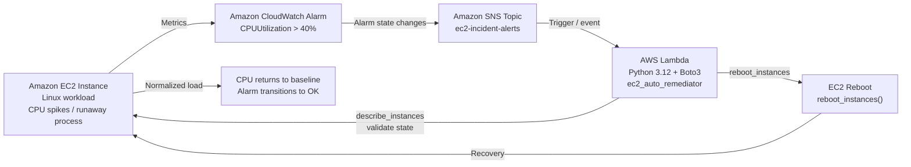

# AWS EC2 Incident Remediation Pipeline

An event-driven AWS monitoring and automated recovery solution that detects EC2 CPU saturation, publishes an alarm through Amazon SNS, and invokes a Lambda function to perform a safe reboot of the impacted instance.

## Overview

This project demonstrates a zero-touch remediation workflow for EC2 workloads experiencing CPU spikes or runaway processes. When CloudWatch detects sustained CPU stress, it publishes an alarm event to an SNS topic. An AWS Lambda function inspects the alarm payload, validates the target instance, and triggers `ec2:RebootInstances` to recover the server without human intervention.

## Architecture



## Problem Statement

When EC2 instances run CPU-intensive workloads or encounter runaway processes, the instance can become unresponsive or severely degraded. Without automated remediation, recovery depends on manual intervention, which slows response time and increases operational risk.

## Solution

This solution uses the following AWS services:

- Amazon EC2 for compute
- Amazon CloudWatch for monitoring and alarm detection
- Amazon SNS for asynchronous event delivery
- AWS Lambda for serverless remediation logic
- AWS IAM for least-privilege permissions

## Key Features

- Proactive anomaly detection using CloudWatch alarms
- Event-driven remediation without human approval
- Lambda-based zero-touch recovery
- Minimal IAM scope for security and compliance
- Simple implementation suitable for learning and production starter patterns

## Repository Structure

```text
aws-ec2-incident-auto-remediation/
├── src/
│   └── lambda_function.py
├── iam/
│   └── lambda-policy.json
├── README.md
└── architecture/
    └── (add diagram assets if needed)
```

## Prerequisites

Before deployment, ensure the following are ready:

- AWS account with permission to create IAM roles, Lambda functions, SNS topics, and CloudWatch alarms
- AWS CLI installed and configured
- Python 3.12 runtime for Lambda
- EC2 instance running on Amazon Linux or another compatible Linux image
- Basic understanding of CloudWatch metric alarm configuration

## Step-by-Step Deployment

### 1. Create the Lambda IAM Execution Role

Create a role named `EC2AutoRemediationLambdaRole` with the trust policy for Lambda:

```json
{
  "Version": "2012-10-17",
  "Statement": [
    {
      "Effect": "Allow",
      "Principal": {
        "Service": "lambda.amazonaws.com"
      },
      "Action": "sts:AssumeRole"
    }
  ]
}
```

Attach the least-privilege policy from `iam/lambda-policy.json`:

```json
{
  "Version": "2012-10-17",
  "Statement": [
    {
      "Sid": "EC2StateReadAndRebootPermissions",
      "Effect": "Allow",
      "Action": [
        "ec2:DescribeInstances",
        "ec2:DescribeInstanceStatus",
        "ec2:RebootInstances"
      ],
      "Resource": "*"
    },
    {
      "Sid": "CloudWatchLogsAccess",
      "Effect": "Allow",
      "Action": [
        "logs:CreateLogGroup",
        "logs:CreateLogStream",
        "logs:PutLogEvents"
      ],
      "Resource": "arn:aws:logs:*:*:*"
    }
  ]
}
```

### 2. Create the Lambda Function

Create a Lambda function named `ec2_auto_remediator` with the following runtime configuration:

- Runtime: Python 3.12
- Memory: 128 MB
- Timeout: 30 seconds
- Execution role: `EC2AutoRemediationLambdaRole`

Use the code in `src/lambda_function.py`.

### 3. Configure SNS Topic and Lambda Trigger

Create a Standard SNS topic named `ec2-incident-alerts` and configure it as the trigger for the Lambda function.

The function expects the alarm payload to arrive as an SNS event, then extracts the instance ID from the alarm's trigger dimensions.

### 4. Configure CloudWatch Alarm

Create a CloudWatch alarm on the `AWS/EC2` metric `CPUUtilization` with the following settings:

- Period: 300 seconds
- Statistic: Average
- Threshold: Greater than 40%
- Evaluation: 1 datapoint
- Alarm action: Publish to the SNS topic `ec2-incident-alerts`

This ensures that any sustained CPU anomaly can trigger the automated remediation path.

## Runtime Logic

The Lambda function performs the following actions:

1. Reads the SNS message from the event payload
2. Parses the JSON alarm message
3. Extracts `InstanceId` from the alarm trigger dimensions
4. Calls `DescribeInstances` to confirm current EC2 state
5. Only reboots when the instance is in a valid state (`running` or `stopping`)
6. Returns a success or no-op result for every alarm event

## Lambda Code

The Python implementation is stored in `src/lambda_function.py`.

```python
import json
import logging
import boto3

logger = logging.getLogger()
logger.setLevel(logging.INFO)

ec2_client = boto3.client('ec2')


def lambda_handler(event, context):
    logger.info("Received event: %s", json.dumps(event))

    try:
        sns_record = event['Records'][0]['Sns']
        sns_message = json.loads(sns_record['Message'])
    except (KeyError, json.JSONDecodeError) as err:
        logger.error("Failed to parse SNS event payload: %s", str(err))
        return {"statusCode": 400, "body": "Invalid payload"}

    alarm_name = sns_message.get('AlarmName', 'Unknown')
    new_state = sns_message.get('NewStateValue', 'Unknown')
    dimensions = sns_message.get('Trigger', {}).get('Dimensions', [])

    instance_id = None
    for dim in dimensions:
        if dim.get('name') == 'InstanceId':
            instance_id = dim.get('value')
            break

    if not instance_id:
        logger.error("No InstanceId found in alarm dimensions.")
        return {"statusCode": 400, "body": "Instance ID not present"}

    logger.info("Alarm '%s' triggered state '%s' for instance: %s", alarm_name, new_state, instance_id)

    try:
        response = ec2_client.describe_instances(InstanceIds=[instance_id])
        state = response['Reservations'][0]['Instances'][0]['State']['Name']
        logger.info("Current state of instance %s is %s", instance_id, state)

        if state not in ['running', 'stopping']:
            logger.warning("Instance %s is in state '%s'. Skipping reboot action.", instance_id, state)
            return {"statusCode": 200, "body": "No action needed"}

        logger.info("Initiating automated reboot for instance: %s", instance_id)
        ec2_client.reboot_instances(InstanceIds=[instance_id])
        logger.info("Reboot signal successfully dispatched to instance %s", instance_id)

        return {
            "statusCode": 200,
            "body": f"Successfully initiated remediation for {instance_id}"
        }

    except Exception as exc:
        logger.error("Error executing remediation on instance %s: %s", instance_id, str(exc))
        raise exc
```

## Verification and Testing

You can validate the pipeline by generating CPU load on the EC2 instance:

```bash
nohup bash -c 'sha1sum /dev/zero & sha1sum /dev/zero &' > /dev/null 2>&1 &
```

This should trigger the CloudWatch alarm. Once the alarm fires, you should see the Lambda execution log similar to:

```text
[INFO] Alarm 'HighCPU-AutoRemediate-TargetInstance' triggered state 'ALARM' for instance: i-00683c92abf9c8ccd
[INFO] Current state of instance i-00683c92abf9c8ccd is running
[INFO] Initiating automated reboot for instance: i-00683c92abf9c8ccd
[INFO] Reboot signal successfully dispatched to instance i-00683c92abf9c8ccd
REPORT RequestId: ... Duration: 572.27 ms Billed Duration: 1136 ms Memory Size: 128 MB Max Memory Used: 104 MB
```

To confirm recovery, inspect the instance uptime:

```bash
uptime
```

When the CPU load decreases and the alarm condition clears, Amazon CloudWatch should transition the alarm back to `OK`.

## Security Notes

This design follows least-privilege practices by limiting the Lambda role to:

- EC2 instance read and reboot permissions
- CloudWatch Logs write permissions
- No broad administrative or destructive actions

## Cleanup

When finished testing, delete the following resources to avoid additional charges:

- CloudWatch alarm
- SNS topic
- Lambda function
- IAM role and policy
- EC2 test instance (if created only for the lab)

## Summary

This repository provides a simple, practical AWS incident remediation pattern that combines monitoring, messaging, and serverless automation to recover EC2 instances automatically when CPU anomalies occur.

It is ideal for learning AWS event-driven automation, least-privilege IAM design, and operational resilience patterns.

---

For a production deployment, consider adding:

- Alarm suppression or cooldown logic
- Multi-instance support
- Dead-letter queue handling for SNS/Lambda failures
- CloudTrail and Config integration for governance
- Automated rollback or recovery validation steps


"""},{"path":"src/lambda_function.py","content":"import json
import logging
import boto3

logger = logging.getLogger()
logger.setLevel(logging.INFO)

ec2_client = boto3.client('ec2')


def lambda_handler(event, context):
    logger.info("Received event: %s", json.dumps(event))

    try:
        sns_record = event['Records'][0]['Sns']
        sns_message = json.loads(sns_record['Message'])
    except (KeyError, json.JSONDecodeError) as err:
        logger.error("Failed to parse SNS event payload: %s", str(err))
        return {"statusCode": 400, "body": "Invalid payload"}

    alarm_name = sns_message.get('AlarmName', 'Unknown')
    new_state = sns_message.get('NewStateValue', 'Unknown')
    dimensions = sns_message.get('Trigger', {}).get('Dimensions', [])

    instance_id = None
    for dim in dimensions:
        if dim.get('name') == 'InstanceId':
            instance_id = dim.get('value')
            break

    if not instance_id:
        logger.error("No InstanceId found in alarm dimensions.")
        return {"statusCode": 400, "body": "Instance ID not present"}

    logger.info("Alarm '%s' triggered state '%s' for instance: %s", alarm_name, new_state, instance_id)

    try:
        response = ec2_client.describe_instances(InstanceIds=[instance_id])
        state = response['Reservations'][0]['Instances'][0]['State']['Name']
        logger.info("Current state of instance %s is %s", instance_id, state)

        if state not in ['running', 'stopping']:
            logger.warning("Instance %s is in state '%s'. Skipping reboot action.", instance_id, state)
            return {"statusCode": 200, "body": "No action needed"}

        logger.info("Initiating automated reboot for instance: %s", instance_id)
        ec2_client.reboot_instances(InstanceIds=[instance_id])
        logger.info("Reboot signal successfully dispatched to instance %s", instance_id)

        return {
            "statusCode": 200,
            "body": f"Successfully initiated remediation for {instance_id}"
        }

    except Exception as exc:
        logger.error("Error executing remediation on instance %s: %s", instance_id, str(exc))
        raise exc
"""},{"path":"iam/lambda-policy.json","content":"{
  "Version": "2012-10-17",
  "Statement": [
    {
      "Sid": "EC2StateReadAndRebootPermissions",
      "Effect": "Allow",
      "Action": [
        "ec2:DescribeInstances",
        "ec2:DescribeInstanceStatus",
        "ec2:RebootInstances"
      ],
      "Resource": "*"
    },
    {
      "Sid": "CloudWatchLogsAccess",
      "Effect": "Allow",
      "Action": [
        "logs:CreateLogGroup",
        "logs:CreateLogStream",
        "logs:PutLogEvents"
      ],
      "Resource": "arn:aws:logs:*:*:*"
    }
  ]
}
"}]}